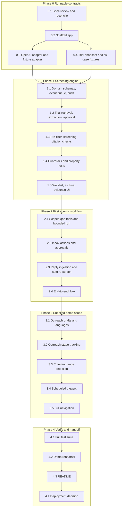

# Implementation Plan: Trial Prescreening Agent

## Overview

This implementation plan was prepared by Codex from the user-selected design; when Kiro performs the implementation, that work must be attributed to Kiro. The strategy is phased and incremental: Phase 0 establishes runnable contracts, Phase 1 proves the screening engine before expanding the UI, Phase 2 delivers the first complete agentic workflow, Phase 3 completes the supplied demo scope, and Phase 4 verifies and prepares the handoff. requirements.md and design.md are authoritative; read both before implementing. Tasks 0.1–0.2 were completed by Kiro; tasks 0.3–0.4 were implemented and checked by Codex. Phase 1 now has a verified seeded-trial screening slice; remaining gates are stated below. Phase 2 onward remains pending. A checkbox is completed only after its stated gate passes.

## Phase 0 verification (October 24, 2026)

- Kiro: spec review/traceability and scaffold; commits `feee48a` and `6c82278`.
- Codex: Agents SDK 0.21.0 adapter, exact fixture replay, live model probes, bounded scoped tools, public NCT06116682 snapshot and six hand-authored synthetic cases.
- `npm test`: 29 tests passed; `npm run typecheck` and `npm run build` passed.
- `npm run ai:probe`: structured probes passed for `gpt-6-astra` and `gpt-6-luna`; live scoped chart read succeeded. SDK mock-model test rejected excess executions after six tool actions.
- `npm run ai:smoke`: three published criterion paragraphs extracted and screened against one synthetic patient; result coverage and exact citation checks passed. This is not full-trial accuracy or clinical validation.
- Fixture checklist preserves all 42 source paragraphs as draft conditions. Atomic decomposition, full AND/OR review, database persistence and coordinator approval remain tasks 1.1–1.2. Expected cohort statuses are annotations for future guardrail tests, not computed decisions.

## Seeded workflow verification (October 24, 2026, Codex)

- Implemented domain persistence, version/revision-bound checklist approval, deduplicated event processing, stale-job rejection, evidence results and append-only audit/chart storage.
- Implemented Trials, Worklist, Archive and Activity with editing, approvals, patient evidence, pending visit checks, stale/error/empty states and responsive layouts.
- Computed all six fixture outcomes independently of expected-status annotations: one potential match, two missing-info cases, one review case and two exclusions. Browser walkthrough verified approval, stale evidence, foreign-citation rejection, archive, activity and no-op duplicate screening.
- Added nine fast-check properties (100 cases each) plus unit/integration tests. Current suite: 52 tests. Typecheck and production build pass. Live full-trial screening has not been validated in this slice.
- Task 1.2 is partial: seeded snapshot review/edit/approval and immutable versions work. Registry import/error handling now works (see checkpoint below); reviewed atomic AND/OR extraction remains incomplete.
- Task 1.4 is partial: the three demo numeric thresholds, citation/date/conflict checks and exact synthetic assertions are guarded. Generalized clinical semantics, compound-rule evidence policies, and broader reference-range support remain incomplete. Unrecognized cases fail to review; no clinical validation is claimed.
- Task 1.5 gate is verified for the current seeded, approved checklist. This does not imply completion of the outstanding 1.2/1.4 gates.
- The API is a typed `/api/workflow` action endpoint and uses two-second polling. Separate REST resources, SSE and a distributed worker are not implemented.

## Registry import checkpoint (October 24, 2026, Codex)

- Added NCT ID validation, ClinicalTrials.gov v2 retrieval, safe registry/extraction errors, snapshot history, per-trial versions and trial selection.
- Imports remain unapproved. Unchanged screening content skips extraction and preserves the checklist; changed content creates a draft and makes old results stale. Extraction races cannot overwrite coordinator edits. Switching the selected trial does not invalidate another trial's queued job.
- Current suite: 62 tests pass, typecheck and production build pass. Migration 0003 applied to the existing local database without resetting history. Browser reimport of NCT06116682 reached the real registry and preserved approved v2. New/changed import tests use a controlled adapter; they do not establish full-trial live extraction accuracy.
- Tasks 1.2 and 1.4 remain partial: atomic compound-rule review and generalized evidence policies are still required. No new Kiro interaction occurred in this checkpoint.

## Task Dependency Graph



The same dependency order is expressed below as sequential execution waves. Each phase runs after the prior phase completes; within Phase 0, 0.3 and 0.4 can proceed in parallel once 0.2 is done.

```json
{
  "waves": [
    { "id": 0, "tasks": ["0.1"] },
    { "id": 1, "tasks": ["0.2"] },
    { "id": 2, "tasks": ["0.3", "0.4"] },
    { "id": 3, "tasks": ["1.1"] },
    { "id": 4, "tasks": ["1.2"] },
    { "id": 5, "tasks": ["1.3"] },
    { "id": 6, "tasks": ["1.4"] },
    { "id": 7, "tasks": ["1.5"] },
    { "id": 8, "tasks": ["2.1"] },
    { "id": 9, "tasks": ["2.2"] },
    { "id": 10, "tasks": ["2.3"] },
    { "id": 11, "tasks": ["2.4"] },
    { "id": 12, "tasks": ["3.1"] },
    { "id": 13, "tasks": ["3.2"] },
    { "id": 14, "tasks": ["3.3"] },
    { "id": 15, "tasks": ["3.4"] },
    { "id": 16, "tasks": ["3.5"] },
    { "id": 17, "tasks": ["4.1"] },
    { "id": 18, "tasks": ["4.2"] },
    { "id": 19, "tasks": ["4.3"] },
    { "id": 20, "tasks": ["4.4"] }
  ]
}
```

## Tasks

- [x] 0.1 Review the spec and reconcile ambiguities in Kiro
  - Map requirements R1–R7 to modules and tests.
  - Preserve trial-first scope and explicit uncertainty; record substantive Kiro changes with reasons.
  - Verify ClinicalTrials.gov API v2 response field names against current official documentation before any integration code depends on them.
  - Gate: requirement-to-module/test map recorded; trial-first scope and uncertainty preserved; verified v2 field names captured; any Kiro changes documented with reasons.
  - _Requirements: R1, R2, R3, R4, R5, R6, R7_

- [x] 0.2 Scaffold the single Next.js/TypeScript application
  - Create one Next.js/TypeScript app with React UI, Node route handlers, SQLite migrations, shared Zod schemas, and a test runner.
  - Add real setup commands, environment variable names, and a health endpoint.
  - Pin Zod v4 (not v3) — the `@openai/agents` SDK requires Zod v4; the shared validation layer depends on it.
  - Create a committed `.env.example` listing `OPENAI_API_KEY` (no value); the real `.env` stays gitignored and server-only.
  - Gate: fresh install, migration, seed, typecheck, and local start succeed; secrets are server-only; Zod v4 is installed and the shared schema module compiles; `.env.example` exists with no secret value.
  - _Requirements: R2, R7_

- [x] 0.3 Add the OpenAI adapter, Agents SDK gap runner, and fixture adapter
  - Add a server-only OpenAI adapter and an OpenAI Agents SDK (`@openai/agents`) gap runner; verify a structured response and one scoped read-tool call with the configured model.
  - Verify the `@openai/agents` structured-output mechanism and the current OpenAI model ID and SDK version against current official documentation before writing integration code.
  - Implement a startup model probe that tries a prioritized list of models callable by the account's `OPENAI_API_KEY` and pins the first available into a single `MODEL_CONFIG` with `SCREENING_MODEL` (strongest reasoning, for `extract`/`screen`) and `GAP_MODEL` (faster/cheaper, for the gap loop); if only one model is available, use it for both and record that.
  - Implement `extract` and `screen` as single structured calls with a Zod v4 `outputType` and `maxTurns: 1`, no tools.
  - Implement `runGapInvestigation` as the only Agents SDK `run()` loop, with the six patient-scoped tools via `tool({ parameters, execute })`.
  - Enforce the six-tool-action cap with a per-run context counter (not `maxTurns`, which counts turns); set `maxTurns` ~12 as a backstop and `resetToolChoice: true`; the run history feeds the Activity trail.
  - Add a visibly labeled deterministic fixture adapter for UI development, repeatable tests, and outage fallback.
  - Gate: real smoke-test result or precise access blocker recorded; no fallback misrepresented as live AI; verified SDK structured-output mechanism and model/version captured; the probe records the pinned `SCREENING_MODEL` and `GAP_MODEL` (or the exact access blocker), a real structured response and one scoped read-tool call succeed, and the code-enforced six-tool cap is demonstrated; no fixture run is presented as live.
  - _Requirements: R3, R4_

- [x] 0.4 Capture one real trial snapshot and author the six-case fixtures
  - Select and capture one real oncology trial snapshot.
  - Create the single shared synthetic cohort of six cases mapping one-to-one to the six requirement scenarios: supported match, valid exclusion, stale labs/imaging, missing treatment history, conflicting/invalid citation, and unrelated cancer type; this is the same cohort referenced by requirements and design.
  - Hand-annotate expected rules and outcomes before any model execution.
  - Gate: fixture source/provenance and expected evidence dates/units recorded; no real patient data; six fixtures map to the six scenarios.
  - _Requirements: R1, R2_

- [x] 1.1 Implement persisted domain schemas, event queue, and audit log
  - Implement persisted domain schemas, the event queue, and the audit log with version IDs, unique keys, and an injectable clock.
  - Gate: migration/seed and duplicate-event tests pass.
  - _Requirements: R2, R7_

- [ ] 1.2 Implement trial retrieval, criteria extraction, and approval
  - Implement trial retrieval, criteria extraction, coordinator editing/approval, and immutable versions.
  - Confirm ClinicalTrials.gov v2 field usage matches the names verified in 0.1.
  - Gate: malformed ID/network/error tests, zero-rule rejection, AND/OR preservation, and unapproved-screen prevention pass.
  - _Requirements: R1_

- [x] 1.3 Implement pre-filter, screening schema, and citation checks
  - Implement the code pre-filter, the model screening schema, citation checks, and result completion.
  - Gate: foreign line IDs, missing/duplicate rules, empty/altered quotes, negation, and chart prompt-injection fixtures cannot yield unsupported matches.
  - _Requirements: R2, R3_

- [ ] 1.4 Implement deterministic guardrails and property tests
  - Implement guardrails for evidence support, dates, numeric units/reference ranges, and deterministic status.
  - Gate: example and property tests cover all status branches, stale unfavorable evidence, boundary dates, unsupported units, conflicts, and pending visit checks; a fabricated citation cannot silently exclude a patient.
  - _Requirements: R3_
  - _Properties: 1, 2, 3, 4, 5, 6, 7, 8_

- [x] 1.5 Connect screening events to worklist/archive and evidence UI
  - Connect screening events to the worklist/archive and a minimal evidence-detail UI.
  - Gate: a current approved checklist produces inspectable seeded outcomes and a stale model job cannot overwrite a newer result.
  - _Requirements: R3, R7_

- [ ] 2.1 Implement scoped gap tools and bounded model-selected execution
  - Implement scoped gap tools and real model-selected bounded execution.
  - Gate: six-call cap, duplicate-call protection, tool failures, existing-evidence discovery, missing records, and forced summary all behave as specified; Activity shows actual choices.
  - _Requirements: R4_
  - _Properties: 9, 10_

- [ ] 2.2 Add inbox actions and server-enforced approvals
  - Add inbox actions for request approval, questions, and match review with reasons.
  - Gate: server rejects unsupported/stale actions; repeat approval cannot duplicate dispatch; new test proposals remain simulated drafts.
  - _Requirements: R5_
  - _Properties: 11, 12_

- [ ] 2.3 Implement synthetic reply ingestion and automatic re-screening
  - Implement synthetic reply ingestion and automatic re-screening.
  - Gate: a result adds one append-only chart line, queues one effective recheck, resolves only supported rules, and never self-loops.
  - _Requirements: R2, R4, R7_
  - _Properties: 10_

- [ ] 2.4 Complete the end-to-end agentic workflow
  - Complete the trial → approved criteria → screening → gap run → approved request → arriving result → match review flow.
  - Gate: repeatable browser walkthrough with evidence, pending visit checks, clear synthetic/mode labels, and an actual OpenAI Agents SDK tool run; record actual output and failures.
  - _Requirements: R1, R2, R3, R4, R5_

- [ ] 3.1 Add outreach draft generation, languages, and review
  - Add physician-note and patient-summary draft generation, language selection, and review/edit/approve.
  - Gate: synthetic doctor delivery requires current approval; patient summary is care-team handoff only; translations show draft status.
  - _Requirements: R6_
  - _Properties: 11, 12_

- [ ] 3.2 Add outreach stage tracking with human-entered outcomes
  - Add outreach stage tracking with human-entered outcomes and terminal reasons.
  - Gate: invalid transitions are rejected and trial closure stops pending delivery without losing history.
  - _Requirements: R6_

- [ ] 3.3 Add criteria-change detection, diff, and cohort invalidation
  - Add criteria-change detection, a reviewable diff, and cohort invalidation/re-screening.
  - Gate: unchanged content creates no spurious draft; simulated changed criteria pause actions; approval triggers new versioned results.
  - _Requirements: R1, R7_

- [ ] 3.4 Wire scheduled and triggered checks through shared handlers
  - Wire nightly trial/schedule checks, new-information/reply triggers, and stalled-step checks to shared persisted handlers.
  - Gate: simulated-clock tests cover two business days, day-before visit, five-day scheduling, and deduplicated reminder drafts; no unapproved external send.
  - _Requirements: R6, R7_
  - _Properties: 12_

- [ ] 3.5 Finish Inbox, Worklist, Trials, Archive, and Activity navigation
  - Finish navigation across Inbox, Worklist, Trials, Archive, and Activity with evidence highlighting and next-visit ordering.
  - Gate: keyboard use, empty/error/stale states, visible pending checks, and synthetic labels work.
  - _Requirements: R5_

- [ ] 4.1 Run the full property, unit, and integration suite
  - Run the full property, unit, and event/approval integration suite, including duplicate events, provider outage, interrupted jobs, stale approvals, and simultaneous chart/checklist changes.
  - Gate: report exact passing commands and remaining failures; no invented coverage or accuracy.
  - _Requirements: R1, R2, R3, R4, R5, R6, R7_
  - _Properties: 1, 2, 3, 4, 5, 6, 7, 8, 9, 10, 11, 12_

- [ ] 4.2 Rehearse all three demo moments from reset
  - Rehearse all three demo moments from a reset, using fixture mode for repeatability and a real agent run for agentic evidence.
  - Gate: save observed artifacts/screenshots, mode/model identifiers, run timestamps, and a concise demonstration sequence; a script is not proof of execution.

- [ ] 4.3 Update the product README with verified details
  - Update the product README with verified setup, features, test commands, demo mode, and actual Kiro contributions.
  - Keep team roles and submission logistics on the Space.
  - Gate: another local run can follow documented commands; no unverified impact claims.

- [ ] 4.4 Choose and verify deployment or record the limitation
  - Choose and verify a persistent deployment if needed, or record the exact packaging/run limitation.
  - Gate: accessible working build tested, credentials configured securely, SQLite persistence and worker lifetime confirmed; no deployment is implied by this plan.

## Notes

### Task protocol for Kiro

Before each task, read the root AGENTS.md, steering, these specs, and the three local context documents. After meaningful work, record the actual Kiro tools, changed artifacts, checks/results, and limitations in `.project-context/activity/`; update local state and completed task checkboxes only when the code and the stated gate actually pass. Keep private notes uncommitted. Review Git status and stage only explicit approved files when a commit is requested; preserve existing local loader modifications.

### Execution order and scope

Start with 0.1–0.4 and Phase 1, then prove the Phase 2 workflow before polishing or broadening. If the deadline requires deferring Phase 3 capabilities, leave their boxes unchecked and state the reduced scope explicitly. No arbitrary clinical outcome claims, new services, or extra agent framework should replace the core workflow.

### Conventions

- Tasks marked with `*` are optional; this plan currently marks none optional because the gates are the acceptance signal.
- Each task references specific requirements (Rx) for traceability; guardrail and agentic tasks also reference the design's numbered correctness properties.
- Checkpoints are expressed as per-task gates: ensure the stated checks pass and ask the user if questions arise before checking a box.
